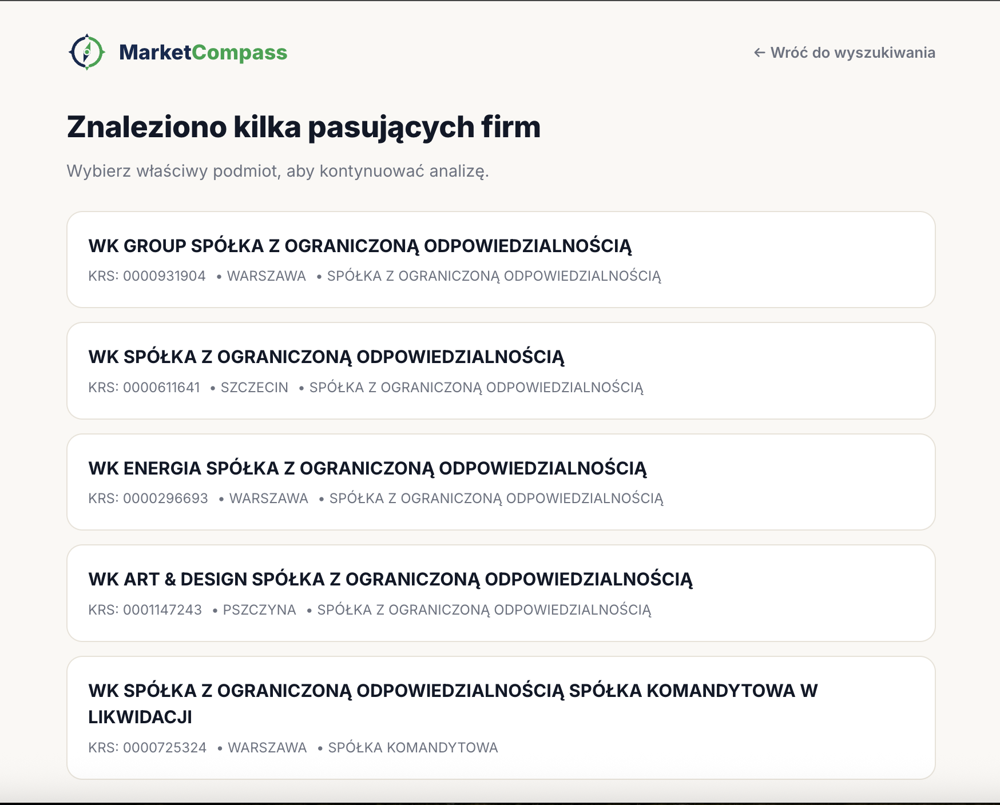
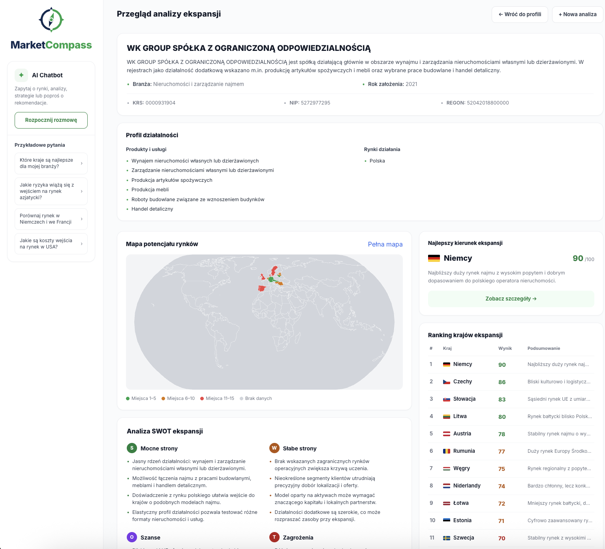
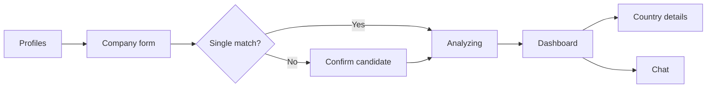
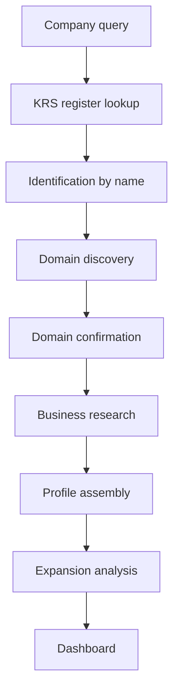

# MarketCompass

AI-powered international expansion analysis for Polish companies. Enter a company name, and MarketCompass identifies the real legal entity in the KRS register, enriches it with web research, and produces a SWOT analysis plus a scored ranking of 15 target countries.

Built as a Master's Thesis project.


---

## Table of Contents

- [Overview](#overview)
- [Screenshots](#screenshots)
- [Features](#features)
- [How It Works](#how-it-works)
- [Tech Stack](#tech-stack)
- [Getting Started](#getting-started)
- [Configuration](#configuration)
- [Scripts](#scripts)
- [Project Structure](#project-structure)
- [Design Principles](#design-principles)
- [Roadmap](#roadmap)
- [Author](#author)
- [License](#license)

---

## Overview

Most AI tools answer "where should my company expand?" from a name typed into a prompt. MarketCompass anchors the answer to a verified input instead:

| Step | What happens |
|------|--------------|
| Identify | The company is matched to a real legal entity in the Polish KRS register |
| Verify | The official website is discovered, confirmed and used as a research source |
| Research | Structured business facts are collected with recorded provenance |
| Analyze | One AI-generated analysis: SWOT plus 15 scored countries with opportunities and risks |

The output always has the same comparable structure, never a freeform essay. The target user is an owner or manager of a Polish SME weighing whether and where to expand abroad.

> The interface is currently in Polish.

---

## Screenshots

### Company identification

When a name matches several registered entities, the user picks the correct one before the analysis continues.



### Expansion dashboard

Company profile, interactive world map, top expansion recommendation, 15-country ranking, SWOT analysis and the MarketCompassAI chat sidebar.



---

## Features

| Feature | Description |
|---------|-------------|
| Company identification | Search by name, with optional founding year and KRS number to narrow results |
| Candidate confirmation | Disambiguation screen when more than one company matches |
| Company profile | Industry, founding year, KRS, NIP and REGON, products and services, operating markets |
| Expansion ranking | Exactly 15 distinct countries, scored 0 to 100 and sorted by score |
| Country details | Per-country opportunities and risks in a detail modal |
| Interactive world map | Natural Earth projection, countries colored by rank band, full-screen view |
| SWOT analysis | Strengths, weaknesses, opportunities and threats for the expansion case |
| Source provenance | Every source records its provider, type and authority level |
| MarketCompassAI chat | Streaming assistant for expansion, trade, economics and strategy questions |
| Saved profiles | Previous analyses are stored in the browser and can be reopened or deleted |

---

## How It Works

The application is a five-screen linear flow. All state lives in the browser session, and the Next.js route handlers are the only backend.



### Research pipeline

Each paid web-research stage is independent and can be switched on or off.



### API routes

| Route | Purpose |
|-------|---------|
| `POST /api/company-research` | Runs the company research pipeline and returns the dashboard |
| `POST /api/company-research/country-details` | Returns opportunities and risks for one country |
| `POST /api/ai/chat` | Streams MarketCompassAI chat responses |

---

## Tech Stack

| Layer | Technology |
|-------|------------|
| Framework | Next.js 15 (App Router) |
| UI | React 19, TypeScript, Tailwind CSS v4 |
| Map | d3-geo |
| AI | OpenAI API (default model `gpt-5.5`) with web search |
| Validation | Zod |
| Company data | KRS (Polish National Court Register) |
| Testing | Node test runner, TypeScript type checks |
| Linting | ESLint 9 |
| Hosting | Vercel |

---

## Getting Started

### Prerequisites

- Node.js 20 or newer
- An OpenAI API key

### Installation

```bash
git clone https://github.com/nowayay/market-compass-app.git
cd market-compass-app
npm install
```

### Environment

Copy the example file and add your key:

```bash
cp .env.example .env.local
```

```env
OPENAI_API_KEY=your_api_key_here
```

### Run

```bash
npm run dev
```

Open [http://localhost:3000](http://localhost:3000).

---

## Configuration

Only `OPENAI_API_KEY` is required. The paid web-research stages are disabled by default and each is enabled independently with its own flag. All other values have defaults. See `.env.example` for the full list.

| Variable | Default | Description |
|----------|---------|-------------|
| `OPENAI_API_KEY` | none | Required. OpenAI API key |
| `OPENAI_MODEL` | `gpt-5.5` | Model used for analysis and chat |
| `KRS_API_TIMEOUT_MS` | `8000` | KRS request timeout in milliseconds |
| `COMPANY_IDENTIFICATION_ENABLED` | `false` | Enables company identification by name |
| `COMPANY_DOMAIN_DISCOVERY_ENABLED` | `false` | Enables official domain discovery |
| `COMPANY_DOMAIN_CONFIRMATION_ENABLED` | `false` | Enables evidence-backed domain confirmation |
| `COMPANY_BUSINESS_RESEARCH_ENABLED` | `false` | Enables structured business research |

Each stage also supports `*_TIMEOUT_MS`, `*_MAX_TOOL_CALLS`, `*_MAX_OUTPUT_TOKENS`, request-per-window and concurrency limits. These safeguards are process-local and are not a distributed rate limiter.

---

## Scripts

| Command | Description |
|---------|-------------|
| `npm run dev` | Start the development server |
| `npm run build` | Create a production build |
| `npm run start` | Serve the production build |
| `npm run lint` | Run ESLint |
| `npm test` | Run the unit tests |
| `npm run test:typecheck` | Type-check the test files |

---

## Project Structure

```
market-compass-app/
├── app/                          Next.js App Router
│   ├── api/
│   │   ├── ai/chat/              Streaming chat route
│   │   └── company-research/     Research and country-details routes
│   ├── layout.tsx
│   └── page.tsx
├── src/
│   ├── screens/                  Profiles, form, confirm, analyzing, dashboard
│   ├── components/               Chat, modals, map and dashboard cards
│   ├── contracts/                Zod schemas and shared types
│   ├── lib/                      Client helpers and localStorage persistence
│   ├── data/                     Static reference data
│   └── server/
│       ├── ai/                   OpenAI client, prompts, chat streaming
│       ├── company-research/     KRS, identification, domains, business research,
│       │                         profile assembly, expansion analysis
│       └── rateLimit/            Process-local request limiting
├── PRODUCT.md                    Product definition
├── DESIGN.md                     Design notes
└── .env.example                  Environment template
```

---

## Design Principles

| Principle | Detail |
|-----------|--------|
| Verified input, structured output | The analysis is tied to a real legal entity and always resolves into the same deliverable |
| No personal data | Board members, shareholders, representatives, beneficial owners and employees are never stored, transmitted or returned |
| Privacy-safe provenance | Public source URLs are reduced to scheme and host; exact page URLs, titles and snippets never reach the client |
| Coarse location only | City, region and country, never a street address |
| No accounts, no database | Profiles persist in browser `localStorage` on a single device |
| Cost control | Each paid research stage is feature-flagged, off by default, and capped per time window |

---

## Roadmap

| Status | Item |
|--------|------|
| Done | Next.js 15 migration |
| Done | MarketCompassAI streaming chat |
| Done | KRS company lookup and identification by name |
| Done | Company web research pipeline |
| Done | Expansion dashboard with world map, ranking and SWOT |
| Planned | Final UI polish |
| Planned | PDF report generation |
| Planned | Authentication and database |
| Planned | Installable PWA support |

---

## Author

**nowayay** - Master's Thesis project

---

## License

This project is intended for educational purposes as part of a Master's Thesis.
